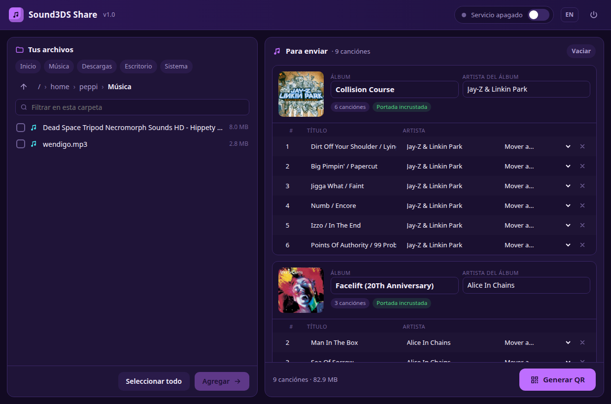
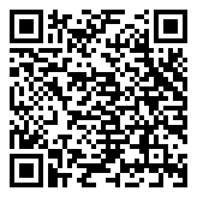
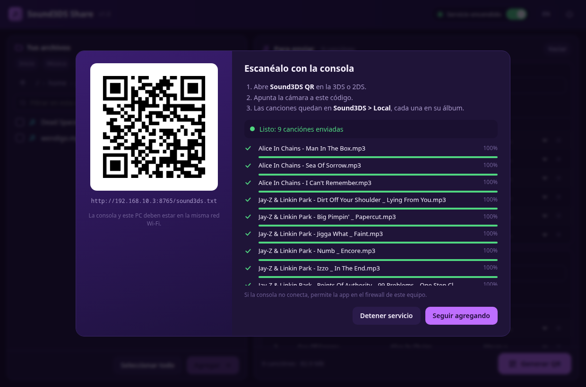
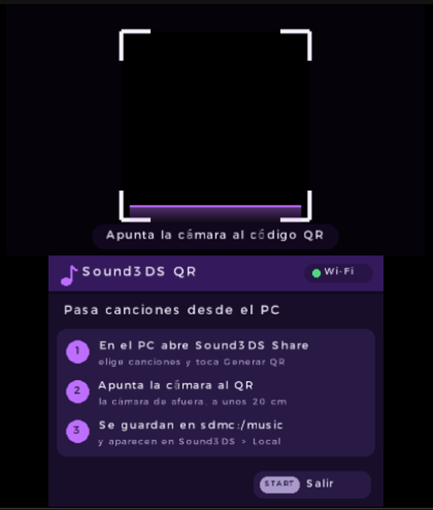
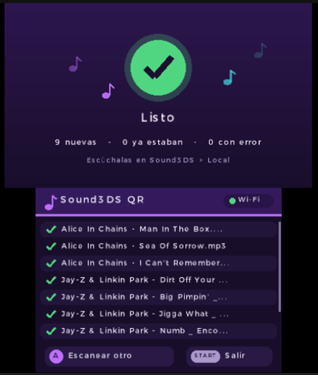

# Sound3DS Share 📲🎵

**English** | [Español](README.es.md)

### Send music from your PC to your Nintendo 3DS / 2DS by scanning a QR code

**Sound3DS Share** sends songs from your PC to your console over Wi-Fi, without taking out the SD card. You pick the songs on your PC, check their albums and cover art, and the console downloads them when you scan a QR code. They end up ready in **[Sound3DS](https://github.com/PeppiDev/sound3ds) > Local**, each one in its album in the cover flow.

It's two programs that work together:

| | Runs on | What it does |
|---|---|---|
| **Sound3DS Share** | PC (Linux or Windows) | Browses your files, builds the list by album and generates the QR code |
| **[Sound3DS](https://github.com/PeppiDev/sound3ds)** 0.7 or newer | 3DS / 2DS / New 3DS | In **Settings → Receive from PC** it scans the QR code with the camera and downloads the songs to `sdmc:/music` (or connects your SoundCloud account) |
| **Sound3DS QR** (optional) | 3DS / 2DS / New 3DS | The older standalone app that does the same; not needed with Sound3DS 0.7 |

<p align="center">
  
</p>

---

## 📥 Installation

### On the console: Sound3DS
Install **[Sound3DS](https://github.com/PeppiDev/sound3ds)** with the QR code in its repository. Since version 0.7 it has the QR reader built in under **Settings → Receive from PC**, so you don't need anything else.

#### Optional: Sound3DS QR
If you prefer the standalone app (or use an older version of Sound3DS):
<p align="center">
  <a href="https://github.com/PeppiDev/sound3ds-share/releases/latest/download/sound3ds-qr.cia">
    
  </a>
</p>

On your console, open **FBI → Remote Install → Scan QR Code** and scan the code: it installs the `.cia` of the latest release. When it finishes, Sound3DS QR shows up on the HOME menu. Requires a console with CFW (Luma3DS) and Wi-Fi.

You can also download `sound3ds-qr.cia` (or `sound3ds-qr.3dsx` for the Homebrew Launcher) from [Releases](https://github.com/PeppiDev/sound3ds-share/releases/latest).

You listen to the songs in **Sound3DS > Local**.

### On the PC: Sound3DS Share
Download the executable for your system from [Releases](https://github.com/PeppiDev/sound3ds-share/releases/latest):

| System | File | How to open it |
|---|---|---|
| **Windows 10 / 11** | `Sound3DS-Share.exe` | Double-click it. The first time, Windows asks about the firewall: check **Private networks** and click **Allow access**, otherwise the console won't be able to connect. If SmartScreen shows up ("Windows protected your PC"), click **More info → Run anyway**. |
| **Linux** | `Sound3DS-Share` | Make it executable (`chmod +x Sound3DS-Share` or Properties → Permissions → "Allow executing") and open it. Works on almost any recent distro: Ubuntu 20.04+, Debian 11+, Fedora, Arch, Mint, openSUSE, Pop!_OS... |

Nothing else to install. The interface opens as its own window if you have Edge, Chrome, Chromium or Brave (Windows always ships Edge); otherwise it opens in your default browser.

<details>
<summary>Linux: add it to your application menu (optional)</summary>

```bash
install -Dm755 Sound3DS-Share ~/.local/bin/Sound3DS-Share
cat > ~/.local/share/applications/sound3ds-share.desktop <<EOF
[Desktop Entry]
Type=Application
Name=Sound3DS Share
Comment=Send songs to your console with Sound3DS QR
Exec=$HOME/.local/bin/Sound3DS-Share %F
Icon=audio-x-generic
Terminal=false
Categories=AudioVideo;Audio;
EOF
```
</details>

---

## 🚀 How to use it

1. **On the PC**, open Sound3DS Share.
2. **Browse your folders** on the left. Check songs and click **Add**, or use **+ folder** to add a whole folder (double-clicking a song works too).
3. **Review the list** on the right. Songs are grouped by album with the cover art and tags they have. Fix whatever you want (see below).
4. Click **Generate QR**.
5. **On the console**, open **Sound3DS → Settings → Receive from PC** (or the Sound3DS QR app) and point the outer camera at the QR code, about 20 cm (8 in) away.
6. The console downloads the songs and the PC shows the progress of each one. When it's done, open them in **Sound3DS > Local**.

<p align="center">
  
</p>

<p align="center">
  
  &nbsp;
  
  <br>
  <em>Sound3DS QR looking for the code, and after the download</em>
</p>

---

## ☁️ Connect your SoundCloud account

With your account connected, Sound3DS shows your **likes, playlists and feed** on the console.

1. Click the orange **Connect SoundCloud** button at the top. Read the warning and continue.
2. SoundCloud's **official sign-in page** opens in a separate window (Edge, Chrome, Chromium or Brave). Log in as usual: email, Google, Apple or two-step verification. **Your password never goes through Sound3DS Share.**
3. Once you're in, the window closes by itself and a QR code shows up. On the console open **Sound3DS → Settings → Receive from PC** and scan it.

The QR code carries a **single-use** link that expires in 10 minutes; it doesn't carry your session. Sound3DS Share doesn't keep the session on the PC: the browser's temporary profile is deleted when it's done.

**Important:** Sound3DS will store your SoundCloud session on the SD card. Anyone who copies the SD card could use your account. Don't share the card, and use **Disconnect** in Settings if you lend or sell it. This is not an official SoundCloud integration: it uses the same API as their website and could stop working if SoundCloud changes it.

If you have none of those browsers, the gear (Settings) has an advanced option to paste the session by hand.

---

## 💿 Albums, cover art and tags

Sound3DS sorts your local music by each song's **album tag**, not by folders. Sound3DS Share lets you get that right before sending.

**Detected automatically:**
- Title, artist, album, album artist and track number from the ID3 tags.
- The cover art embedded in the song. If it has none, `cover.jpg`, `folder.jpg` or `front.jpg` from its folder is used.
- If the title or artist is missing, they're taken from the file name (`01. Artist - Title.mp3`).

**You can change:**
- **Album name** and **album artist**: applied to every song in the album. If you type the name of another album in the list, they're merged.
- **Track number, title and artist** of each song, right in the table.
- **Move to**: moves a song to another album in the list or to a new one.
- **Cover art**: click the square to pick an image (JPG or PNG). If an album has no cover, the square is shown in orange. If its songs have different covers, click the **unify** badge to use the main one for all of them.

Your songs on the PC are **not modified**. When they're sent, they get a new tag with what you see on screen and the cover art scaled down to 500 px, the size the console handles best. On the console they're saved as `Artist - Title.mp3`.

You can send `.mp3` and `.aac` files, which are the formats Sound3DS plays.

---

## 🎮 Sound3DS QR on the console

- The camera image is shown on the top screen with a viewfinder. When the code is recognized, the corners turn green.
- While downloading, the top screen shows the overall progress, the current song, MB and speed. The bottom screen shows the list with the status of each song.
- **(B)**: cancels the download. **HOME** works while downloading, and closing the lid doesn't interrupt it.
- **(A)**: scan another QR code when it's done. **START**: exit.
- Songs that are already on the SD card are skipped.
- It uses the same language you picked in Sound3DS (English or Spanish).

The QR code can also be the URL of a single `.mp3`/`.aac`, or of a text list with one URL per line.

---

## 🛠️ Troubleshooting

| Problem | What to check |
|---|---|
| The console reads the QR code but doesn't download | That the PC and the console are on the **same Wi-Fi network** and that the firewall allows Sound3DS Share (on Windows, "Private networks"). Some guest networks isolate devices from each other. |
| The PC has several networks (VPN, Tailscale, cable + Wi-Fi) | At the top, next to the service switch, pick your home network's IP address and generate the QR code again. |
| The camera doesn't recognize the code | Move a bit closer or farther, avoid reflections on the PC screen and turn up the brightness. |
| The window doesn't show up | The app opens your browser at `http://127.0.0.1:8764`. You can open that address by hand. |

**Ports:** the interface uses `127.0.0.1:8764` and is only reachable from your PC, since it can browse your files. The console connects to port `8765` (or the next free one), which only serves the songs in the list.

---

## 🔧 Building

### PC
From source, with Python 3.9 or newer:
```bash
cd pc
pip install -r requirements.txt
python3 sound3ds_share.py
```

Executables (require `podman`):
```bash
./pc/build_linux.sh     # pc/dist/linux/Sound3DS-Share (built on Debian 11, glibc 2.31)
./pc/build_windows.sh   # pc/dist/windows/Sound3DS-Share.exe (Windows Python under Wine)
```

### Console
With the devkitARM image on `podman`:
```bash
./3ds/build.sh          # 3ds/sound3ds-qr.3dsx
./3ds/build_cia.sh      # 3ds/sound3ds-qr.cia (requires makerom and bannertool)
```
`build_cia.sh` looks for the tools in `~/.local/share/3ds-tools`. You can change the path with `CTR_TOOLS_DIR`, or point to each one with `MAKEROM` and `BANNERTOOL`.

### Layout
```
pc/                 Sound3DS Share (Python: server + web interface in pc/web)
3ds/                Sound3DS QR (C, libctru + citro2d)
  source/camera.c   continuous camera capture on its own thread
  source/job.c      list reading and downloads with libcurl
  source/ui.c       interface for both screens
  source/quirc/     QR decoder (ISC license)
docs/               images for this README
```

---

## 🤖 AI usage

This project was made with AI assistance, and I declare it openly. Most of the code (the PC server and web interface, the Sound3DS QR app and the build scripts) and the documentation were written by **Claude** (Anthropic), used as a programming assistant. The icon and banner were also generated with scripts written by the AI. I decide what each app does, review the results and test every version on the PC and on real consoles.

## 🙌 Credits

- [quirc](https://github.com/dlbeer/quirc) (ISC) to read QR codes on the console.
- [mutagen](https://github.com/quodlibet/mutagen), [Pillow](https://python-pillow.org), [python-qrcode](https://github.com/lincolnloop/python-qrcode) and [certifi](https://github.com/certifi/python-certifi) on the PC.
- [devkitPro](https://devkitpro.org) (libctru, citro2d, libcurl) for the console app.
